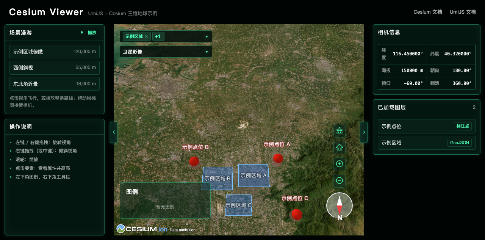

# Cesium Viewer

基于 **UmiJS 4 (max) + React 19 + Cesium + Zustand** 的三维地球示例项目。

从实际 GIS 项目中抽出的**技术骨架**：保留 Cesium 图层加载、相机交互、点图查询、
属性弹窗等通用能力，去掉全部业务数据与生产环境配置。业务服务地址在配置里全部留空
（结构保留），按自己的环境填写即可；底图暂时使用公开的 Esri 示例服务。

> 仓库内的示例区域 / 点位均为虚构数据，不包含任何真实业务数据或生产环境配置。



## 功能

- **三维地球**：Cesium Viewer，ArcGIS SceneView 风格的鼠标操作（左 / 右键旋转、右键倾斜、滚轮缩放）
- **底图切换**：XYZ / WMTS 两种底图，支持多底图下拉切换（默认 Esri 公开影像 / 街道图）
- **专题图层树**：树形多选，按 `type` 分发加载
  - `wfs`：WFS GetFeature → 前端矢量渲染 + 名称标注
  - `wmts`：OGC WMTS 影像图层，支持级号偏移、切片方案、透明度、图例
  - `geojson`：本地静态 GeoJSON，面填充栅格化成影像层 + 贴地边界 + 名称 label
  - `markers`：配置驱动的三维图钉标注（glb），按相机距离换算屏幕大小
  - `query`：查询服务整层取 WKT，前端渲染
  - `3dtiles`：3D Tiles 倾斜模型 / BIM / 点云，支持整体高度偏移
- **点图查询**：点击地图逐层查询 WMTS 要素，命中即停，红色高亮 + 属性弹窗
- **属性弹窗**：字段白名单 + 中英文映射，点击实体高亮
- **图例**：按「服务名 + 样式名 + 当前级号」请求地图服务图例
- **相机漫游**：预设视角飞行 + Catmull-Rom 连续插值播放，鼠标操作自动接管
- **三维地形**：标准 `CesiumTerrainProvider`（quantized-mesh），可配可不配
- **响应式面板**：左右面板可收起（只改 CSS，不卸载内容）

## 技术栈

| 类别     | 技术                    |
| -------- | ----------------------- |
| 框架     | UmiJS 4 (max)           |
| 3D 引擎  | Cesium 1.x              |
| UI       | React 19 + Ant Design 6 |
| 状态管理 | Zustand 5               |
| 语言     | JavaScript              |
| 包管理   | pnpm                    |

## 快速开始

```bash
pnpm install   # 安装依赖，并复制 Cesium 静态资源到 public/cesium/
pnpm dev       # 开发服务器（默认 http://localhost:8000）
pnpm build     # 生产构建，产物在 dist/
```

构建后 `public/` 会原样复制到 `dist/`（含 `config/app.js`、`geojson/`、`models/`），
部署后可直接修改 `dist/config/app.js`，无需重新打包。

## 配置

所有运行时配置集中在 **`public/config/app.js`**，通过 `headScripts` 在应用代码前
加载，挂到 `window.appcfg`，由 `src/utils/appConfig.js` 统一读取。

```js
window.appcfg = {
  title: "Cesium Viewer",
  cesiumIonToken: "",

  // 默认底图：type 支持 "xyz" / "wmts"
  basemap: { type: "xyz", url: "https://.../{z}/{x}/{y}.png" },

  // 可切换底图（为空则只有默认底图）
  basemapServices: [],

  // 标准 Cesium 地形，留空则不挂地形
  terrain: { url: "", requestVertexNormals: true },

  // 3D Tiles 整体抬升（米）
  tilesetHeightOffset: 5,

  // 图层树
  themeOptions: [
    {
      label: "示例区域",
      value: "demo-areas",
      type: "geojson",
      url: "./geojson/demo-areas.geojson",
      // ...样式字段
    },
  ],
  themeDefaults: ["demo-areas"],

  // 服务地址（留空则相关能力静默跳过）
  apiRoot: "",
  mapServerRoot: "",
  mapServices: {},
  legendRoot: "",
  themeQueryRoot: "",

  // 属性弹窗字段白名单
  fieldLabels: { name: "名称" },
};
```

### 接入自己的服务

1. **底图**：把 `basemap` / `basemapServices` 换成自己的 XYZ 或 WMTS 地址。
2. **WFS**：填 `mapServerRoot` 与 `mapServices`，在 `themeOptions` 里加
   `{ type: "wfs", service: "yourKey", typeName: "layer:name" }`。
3. **WMTS**：直接在条目里写 `url` / `layer` / `style` / `tileMatrixSetID`；
   服务级号比 Cesium 大时用 `levelOffset` 或 `tileMatrixLabels` 映射。
4. **3D Tiles**：`{ type: "3dtiles", url: "https://.../tileset.json" }`；
   模型整体偏高 / 偏低时改 `tilesetHeightOffset`。
5. **点图查询 / 图例**：填 `themeQueryRoot` / `legendRoot`，WMTS 条目带
   `serverName` 后会自动登记查询源与图例源。

### 图层类型字段

| type      | 必填字段              | 主要可选字段                                                             |
| --------- | --------------------- | ------------------------------------------------------------------------ |
| `wfs`     | `service`、`typeName` | `showLabel`、`labelField`、`hoverFields`                                 |
| `wmts`    | `url`                 | `layer`、`style`、`tileMatrixSetID`、`levelOffset`、`rectangle`、`alpha` |
| `geojson` | `url`                 | `fillColor`、`fillOpacity`、`strokeColor`、`strokeWidth`、`showLabel`    |
| `markers` | `points`              | `pixelHeight`、`modelUrl`、`labelColor`                                  |
| `query`   | `serverName`          | `queryLayerName`、`nameField`、填充 / 边界样式                           |
| `3dtiles` | `url`                 | `maximumScreenSpaceError`、`locateOnLoad`                                |

## 目录结构

```
public/
├── cesiumInit.js          # 设置 CESIUM_BASE_URL（必须在 Cesium JS 之前）
├── config/app.js          # 运行时配置（结构示例，地址留空）
├── geojson/               # 示例 GeoJSON（虚构数据）
├── models/demo-pin.glb    # 标注点三维图钉
└── cesium/                # pnpm install 时从 node_modules 复制（已 gitignore）

src/
├── components/
│   ├── CesiumViewer/      # Viewer 初始化、相机、实体点击 / 悬停
│   ├── map-components/    # ThemeSwitcher / BasemapSwitcher / PointQuery
│   ├── LeftPanel|RightPanel|PanelCard
│   ├── FeaturePopup|HoverPopup|Legend|Toolbar
│   └── CameraTour|CameraInfo|LayerStatus
├── pages/Globe/           # 示例页
├── services/              # 图例、要素查询
├── stores/                # useCesiumStore / useMapStore
└── utils/
    ├── appConfig.js       # 运行时配置读取
    ├── camera/            # 视角飞行、漫游插值
    └── layers/            # 各类型图层的加载 / 移除
```

## 实现要点

- **填充为什么是影像层**：Cesium 的绘制顺序是「地球影像 → 地面图元 → 矢量图元」，
  矢量面永远压在所有影像之上。要让面填充垫在切片图层下面，只能把面栅格化成瓦片、
  作为 ImageryLayer 插入指定索引；边界和名称仍用矢量 / label 画，保证清晰。
- **WMTS 级号偏移**：国产 WMTS 的级号常比 Cesium 大 1–N 级，用 `levelOffset`
  生成 `tileMatrixLabels`，否则 Cesium 从 0 级请求会全部落空且无报错。
- **3D Tiles 高度偏移**：左乘平移矩阵修改 `tileset.modelMatrix`，方向取包围球中心
  的椭球法线，整棵树一起抬升，不依赖 tileset.json 里的 transform。
- **相机漫游**：经纬高与姿态分别做 Catmull-Rom（中心差分切线 + Hermite）插值，
  航段之间位置与速度连续，镜头不会一顿一顿。
- **点图查询**：始终带 `spatialFilter`（点击点构造的小矩形），避免全表查询；
  多层从上层到下层逐个试，命中即停。

实现细节都写在对应源码的注释里。

## 说明

- 默认底图使用 Esri 公开瓦片，仅用于演示；正式环境请换成自己的
  地图服务，并遵守对应服务的使用条款。地图左下角保留版权信息。
- 示例 GeoJSON 与点位坐标均为虚构，可自由替换。
